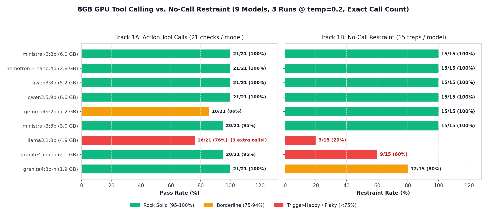
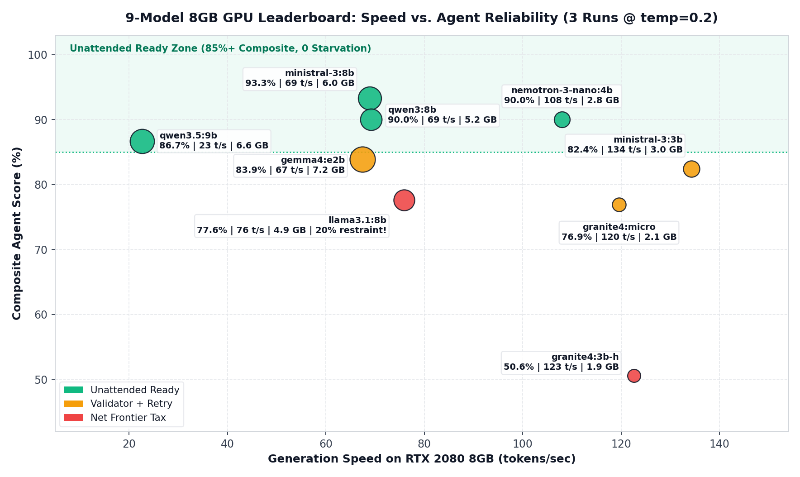
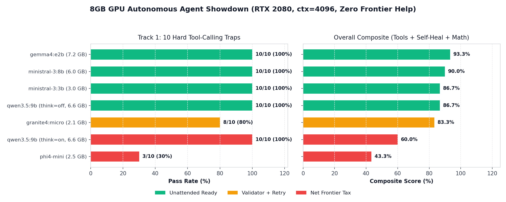
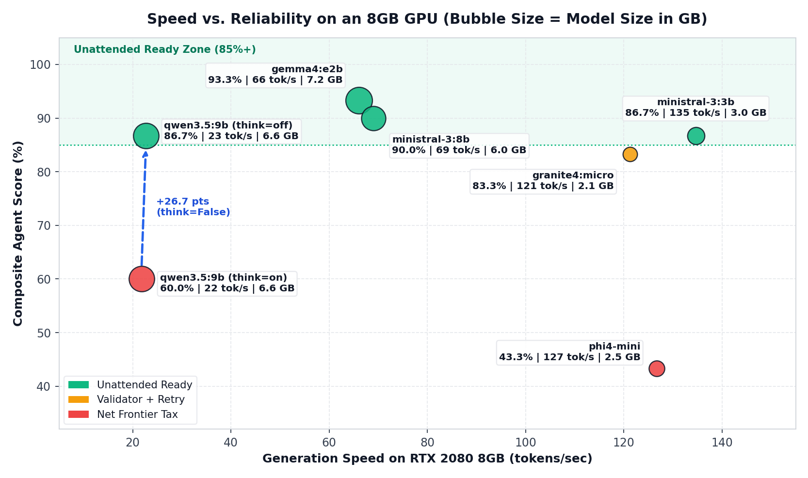
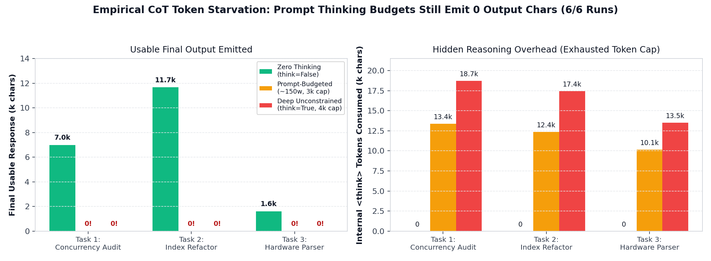
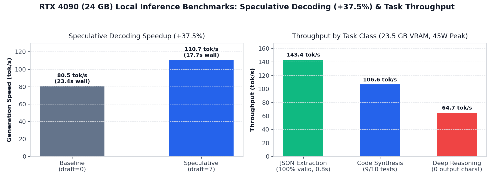

# Local Agentic LLM Evaluation Harness (`local-agent-evals`)

[](https://github.com/Benfinkels/local-agent-evals/actions/workflows/ci.yml)
[](https://www.python.org/downloads/)
[](LICENSE)

**A pass/fail test suite to see which small local Ollama models actually survive inside an AI agent.**

Most benchmarks grade chat vibes or trivia. This zero-dependency Python harness runs real `unittest` pass/fail checks on any local Ollama model to catch the three ways small models break in production: **thinking forever until they output nothing**, **sloppy tool calls**, and **failing to fix their own bugs when given a test error**.



## Quick Start (Test Your Own Ollama Models in 60 Seconds)

```bash
git clone https://github.com/Benfinkels/local-agent-evals.git
cd local-agent-evals
python -m evals.runner --models ministral-3:8b nemotron-3-nano:4b --think false --runs 3 --tool-temp 0.2
```

- Uses **Python standard library only** to run live evals (no SDK dependencies required).
- Point at a remote Ollama box with `--base-url http://<host>:11434` (or `$OLLAMA_HOST`).
- Measure consistency across repeated trials with `--runs 3 --tool-temp 0.2`, and compare thinking modes with `--think auto | true | false`.
- Prints a copy-pasteable Markdown leaderboard and writes JSON to `results/run_<timestamp>.json` (never auto-pulls models or overwrites committed baselines).
- **Want your GPU/model added to the leaderboard?** Run `--runs 3 --tool-temp 0.2` and open an issue or PR with your Markdown table and hardware specs!

### Offline Harness Verification (No GPU Required)
```bash
pip install -r requirements.txt
PYTHONPATH=. pytest tests/ -v
```

---

## Episode 1 Leaderboard: 9 Models on an 8GB RTX 2080 (3 Runs @ `temp=0.2`, Exact Call Count)



Upgraded directly from community feedback on Reddit:
- **Exact single-call enforcement** *(thanks `u/MongooseWonderful198`)*: positive, chain, and repair steps now require `len(tool_calls) == 1` — any model that bundles an extra unwanted tool call fails immediately (verified by a dedicated negative unit test).
- **Standalone No-Call Restraint score** *(thanks `u/AgentSearchEngine`)*: Track 1 is now split cleanly into **Action Tools (`7` cases × 3 runs = `21` checks)** vs. **No-Call Restraint (`5` traps × 3 runs = `15` checks)** so trigger-happy models stand out immediately.

All 9 models ran on a single **8GB RTX 2080** at `num_ctx=4096`, `think=False`, `runs=3`, `tool_temp=0.2` ([`results/showdown_8gb_ep1_3runs.json`](results/showdown_8gb_ep1_3runs.json)):

| Model | Size | Speed | Action Tools (`21`) | No-Call Restraint (`15`) | Extra Calls | Code (`T1->T2`) | Math (`5`) | **Composite** | **Offload Verdict** |
| :--- | :---: | :---: | :---: | :---: | :---: | :---: | :---: | :---: | :--- |
| **`ministral-3:8b`** | 6.0 GB | 69 t/s | **21/21 (100%)** | **15/15 (100%)** | 0 | `6->8 (+2)` | **5/5** | **93.3%** | **Unattended Ready** |
| **`nemotron-3-nano:4b`** | **2.8 GB** | **108 t/s** | **21/21 (100%)** | **15/15 (100%)** | 0 | `7->7 (+0)` | **5/5** | **90.0%** | **Unattended Ready** |
| **`qwen3:8b`** | 5.2 GB | 69 t/s | **21/21 (100%)** | **15/15 (100%)** | 0 | `7->7 (+0)` | **5/5** | **90.0%** | **Unattended Ready** |
| **`qwen3.5:9b`** (`think=False`) | 6.6 GB | 23 t/s | **21/21 (100%)** | **15/15 (100%)** | 0 | `6->6 (+0)` | **5/5** | **86.7%** | **Unattended Ready** |
| **`gemma4:e2b-it-q4_K_M`** | 7.2 GB | 67 t/s | 18/21 (85.7%) | **15/15 (100%)** | 0 | `6->6 (+0)` | **5/5** | **83.9%** | **Validator + Retry** |
| **`ministral-3:3b`** | 3.0 GB | **134 t/s** | 20/21 (95.2%) | **15/15 (100%)** | 0 | `4->5 (+1)` | **5/5** | **82.4%** | **Validator + Retry** |
| **`llama3.1:8b`** | 4.9 GB | 76 t/s | 16/21 (76.2%) | **3/15 (20.0%)** | **3** | `8->8 (+0)` | **5/5** | **77.6%** | **Net Frontier Tax** |
| **`granite4:micro`** | 2.1 GB | 120 t/s | 20/21 (95.2%) | 9/15 (60.0%) | 0 | `5->5 (+0)` | **5/5** | **76.9%** | **Validator + Retry** |
| **`granite4:3b-h`** | **1.9 GB** | 123 t/s | **21/21 (100%)** | 12/15 (80.0%) | 0 | `4->4 (+0)` | 1/5 | **50.6%** | **Net Frontier Tax** |

### Key Findings From the Hardened Multi-Run Suite
- **The exact extra-call bug caught `llama3.1:8b` 3/3 times:** On the 2-step chain (*"check GPU temp, and if >85C send an alert"*), `llama3.1:8b` blindly fired **both** `query_device_telemetry` and `dispatch_alert` simultaneously before even reading the temperature — and over-triggered tools on **12/15** no-call traps (`20%` restraint), even calling `dispatch_alert` when asked *"What does HTTP 429 mean?"*
- **`nemotron-3-nano:4b` (2.8 GB, 108 t/s) is the new small-footprint champ:** Went **36/36** across 3 runs (`21/21` tools, `15/15` restraint, `0` extra calls) + `7/10` code + `5/5` math (**90.0%**), tying `qwen3:8b` at half the VRAM and 1.6× the speed.
- **`ministral-3:8b` (6.0 GB, 69 t/s) took #1 overall (`93.3%`):** Perfect **36/36** on tools + restraint AND healed `6->8/10` on Turn-2 code.
- **`qwen3:8b` beat `qwen3.5:9b` on an 8GB card:** Higher composite (`90.0%` vs `86.7%`) and **3× faster** (`69` vs `23 tok/s`) because `5.2 GB` leaves comfortable KV-cache headroom on 8GB VRAM.
- **Granite 4 models are fast & accurate on schemas, but trigger-happy:** `granite4:3b-h` went `21/21` on actions (`123 t/s`), yet fired a real `dispatch_alert` when asked to write sample documentation text (`12/15` restraint).

---

## Previous Run: 8GB Autonomous Offload Showdown (v2 Single-Run + `qwen3.5` Thinking Toggle)





In response to community feedback (*"Gemma is bad at real tool calls"*, *"how does Mistral hold up?"*, and *"what can you actually offload without paying a frontier babysitter tax?"*), Track 1 was expanded from 3 to **10 strict tool-calling tests** across 5 tools — strict int/bool/array schemas, prose-to-CRM extraction, 3 abstention traps (including missing required fields), a **2-step autonomous tool chain**, and **mechanical validator-error self-repair**.

All models tested on a single **8GB RTX 2080** at `num_ctx=4096` ([`results/showdown_8gb_v2.json`](results/showdown_8gb_v2.json) & [`results/showdown_qwen35_think_on.json`](results/showdown_qwen35_think_on.json)):

| Model | Size | Speed (tok/s) | Track 1: 10 Hard Tool Tests | Track 2: Self-Healing (`T1` $\rightarrow$ `T2`) | Track 3: Bayesian Math | CoT Starved? | **Composite** | **Offload Verdict** |
| :--- | :---: | :---: | :---: | :---: | :---: | :---: | :---: | :--- |
| **`gemma4:e2b-it-q4_K_M`** (`think=False`) | 7.2 GB | 66 | **10/10 (100%)** | `0/10` $\rightarrow$ **`8/10`** *(+8)* | **5/5 (100%)** | No | **93.3%** | **Unattended Ready** |
| **`ministral-3:8b`** | 6.0 GB | 69 | **10/10 (100%)** | `7/10` $\rightarrow$ `7/10` *(+0)* | **5/5 (100%)** | No | **90.0%** | **Unattended Ready** |
| **`ministral-3:3b`** | **3.0 GB** | **135** | **10/10 (100%)** | `6/10` $\rightarrow$ `6/10` *(+0)* | **5/5 (100%)** | No | **86.7%** | **Unattended Ready** |
| **`qwen3.5:9b`** (`think=False`) | 6.6 GB | 23 | **10/10 (100%)** | `6/10` $\rightarrow$ `6/10` *(+0)* | **5/5 (100%)** | No | **86.7%** | **Unattended Ready** |
| **`granite4:micro`** | **2.1 GB** | 121 | 8/10 (80%) | `7/10` $\rightarrow$ `7/10` *(+0)* | **5/5 (100%)** | No | **83.3%** | **Validator + Retry** |
| **`qwen3.5:9b`** (`think=True`) | 6.6 GB | 22 | **10/10 (100%)** | `0/10` $\rightarrow$ **`8/10`** *(+8)* | 0/5 (0%) | **Yes** | **60.0%** | **Net Frontier Tax** |
| **`phi4-mini:latest`** | 2.5 GB | 127 | 3/10 (30%) | `8/10` $\rightarrow$ `8/10` *(+0)* | 1/5 (20%) | No | **43.3%** | **Net Frontier Tax** |

### Zero-Frontier Offload Takeaways
- **Sleeper winner for fast $0 routing (`ministral-3:3b`):** At **3.0 GB** and **135 tok/s** (2x faster than Gemma 4, 6x faster than Qwen 3.5 9B), it hit **10/10** on every strict tool call, abstention trap, 2-step chain, and validator self-repair — obliterating `phi4-mini` (3/10, 0/7 actual tool calls) at nearly the same speed.
- **Gemma 4 E2B held up on hard tools — and self-healed:** Scored **10/10** on the expanded tool suite and was the only non-thinking model to autonomously recover from a failing Python traceback (`0/10 -> 8/10`).
- **One flag flipped Qwen 3.5 9B from Net Frontier Tax to Unattended Ready:** Turning `think=False` jumped `qwen3.5:9b` by **+26.7 points** (`60.0% -> 86.7%`) by eliminating Track 3 token starvation, though it stays 3x–6x slower than `ministral-3`.
- **Where the "Frontier Babysitter Tax" still bites:** Even the best 8GB models topped out at `7–8/10` on tricky multi-constraint Python regex coding without healing to `10/10` — so **unattended offloading works great for structured routing, extraction, alerts, and tool chains (`<1,500` tokens)**, while complex multi-file code still belongs on a frontier model (or behind a deterministic unit-test gate).

---

## Earlier Empirical Scorecard (8GB vs. 24GB Local GPUs)

Evaluated across two local hardware tiers:
* **8GB GPU Tier:** NVIDIA RTX 2080 8GB / GTX 1080 8GB
* **24GB GPU Baseline:** NVIDIA RTX 4090 24GB

| Model | GPU Tier / Footprint | Speed (tok/s) | Track 1: Tool Calling | Track 2: Self-Healing (`Turn 1` $\rightarrow$ `Turn 2`) | Track 3: Bayesian Math | CoT Token Starvation? | **Composite Agent Score** |
| :--- | :--- | :---: | :---: | :---: | :---: | :---: | :---: |
| **`nemotron-3.5-bolt`** *(74B-A9B)* | 24GB RTX 4090 (20.5 GB) | 84–91 | **3/3 (100%)** | `8/10` $\rightarrow$ **`10/10`** *(+2)* | **5/5 (100%)** | Yes *(if `think=True` $\le$ 4k)* | **100.0%** |
| **`gemma4:e2b-it-q4_K_M`** | **8GB RTX 2080 (7.2 GB)** | **60–77** | **3/3 (100%)** | `8/10` $\rightarrow$ **`9/10`** *(+1)* | **5/5 (100%)** | **No (0%)** | **96.7%** |
| **`qwen3.5:9b`** | **8GB RTX 2080 (6.6 GB)** | 22–36 | **3/3 (100%)** | `0/10` $\rightarrow$ **`8/10`** *(+8)* | 0/5 (0%) | **Yes** *(Starved Track 3)* | **60.0%** |
| **`phi4-mini:latest`** | 8GB GPU (2.5 GB) | 125–130 | 1/3 (33.3%) | `0/10` $\rightarrow$ `0/10` | 1/5 (20%) | No | **17.8%** |
| **`nemotron-mini:4b`** | 8GB GPU (2.7 GB) | 126–127 | 1/3 (33.3%) | `0/10` $\rightarrow$ `0/10` | 0/5 (0%) | No | **11.1%** |
| **`deepseek-r1:8b`** | 8GB GPU (5.2 GB) | 66–67 | 0/3 *(HTTP 400)* | `0/10` $\rightarrow$ `0/10` | 0/5 (0%) | **Yes (100% Starved)** | **0.0%** |
| **`nemotron-3-nano`** *(30B-A3B)* | 8GB GPU (24.0 GB) | — | *OOM (HTTP 500)* | *OOM (HTTP 500)* | *OOM (HTTP 500)* | — | *VRAM OOM* |

Full raw JSON telemetry: [`results/benchmark_summary.json`](results/benchmark_summary.json).

---

## Why This Benchmark Exists

Most LLM benchmarks measure single-turn chat fluency or static multiple-choice recall. In real autonomous agent loops, local models fail in three operational ways that standard benchmarks miss:
1. **Runaway CoT Token Starvation:** Reasoning models burn 100% of their `num_predict` token budget inside `<think>...</think>` blocks and emit zero executable code or tool payloads.
2. **Tool Schema Wrapper Hallucinations:** Models support `/api/chat` `tools` on paper, but wrap arguments in hallucinated keys (e.g., `{"parameters": {...}, "type": "..."}`) or call tools when explicitly told to abstain.
3. **Zero Self-Healing Capability:** Inability to read a real `unittest` failure traceback on Turn 2 and patch the failing edge case.

### Key Takeaways
1. **`gemma4:e2b-it-q4_K_M` (7.2 GB) is the Pareto-Optimal 8GB Agent Model:** Hit **96.7% Composite** at **60–77 tok/s** on a single 8GB GPU—97% of the capability of a 24GB 74B-A9B MoE baseline at one-third the VRAM, with zero CoT starvation and autonomous Turn-2 self-healing.
2. **Reasoning Models Starve Under Standard Token Caps:** `deepseek-r1:8b`, `qwen3.5:9b`, and `nemotron-3.5-bolt` frequently exhaust 2,048–4,096 output tokens inside `<think>` blocks before emitting final code. Production agent loops must pass `think=False` or split reasoning vs. output budgets.
3. **4B Models (`phi4-mini`, `nemotron-mini:4b`) Break Strict Tool Routers:** Despite **125+ tok/s**, they frequently wrap tool arguments in hallucinated nested JSON keys that fail Pydantic/JSON-Schema validators.

---

## Core Tracks (Deterministic Unit-Test Grading)

| Track | Capability Tested | Verification Method |
| :--- | :--- | :--- |
| **Track 1: Autonomous Tool Calling & Self-Repair** | 10 strict cases across 5 tools (`run_pytest`, `query_device_telemetry`, `log_crm_interaction`, `dispatch_alert`, `schedule_power_action`): int/bool/array schemas, 3 abstention traps, a 2-step autonomous chain, and validator-error self-repair | Strict Python type/enum/list checks + zero-false-positive abstention (`10/10` cases) |
| **Track 2: 2-Turn Self-Healing Code Loop** | Multi-constraint regex & boundary parser (`parse_hardware_identifiers`). If Turn 1 scores `<10/10`, the raw `unittest` traceback is fed back on Turn 2 | `py_compile` + 10-case `unittest` battery (`Turn 1` vs. `Turn 2` self-healing delta) |
| **Track 3: Sequential Bayesian & Z-Score Math** | Population Z-score outlier filtering ($|x - \mu| > z\sigma$) coupled with $k$-step sequential Bayesian posterior fault updating | 5 exact floating-point `assertAlmostEqual` unit tests (`TestSensorBayes`) |

---

## Phase 2: Multimodal Vision-to-Tool & Verify-Then-Escalate Cascade

### Track 4: Edge Multimodal Vision $\rightarrow$ Structured Tool Dispatch (`gemma4:e2b` on 8GB RTX 2080)
Using a deterministic, zero-dependency PNG OSD synthesizer ([`evals/cascade.py`](evals/cascade.py)), we tested whether an 8GB edge model (`gemma4:e2b-it-q4_K_M`, `think: false`) can inspect raw image frames and emit structured `/api/chat` tool calls in one pass without waking a 24GB workstation GPU:

| Test Case | Synthetic OSD Frame | Expected Behavior | `gemma4:e2b` Result | Latency (RTX 2080) |
| :--- | :--- | :--- | :--- | :--- |
| **`thermal_critical`** | `NODE: GPU-4090 / TEMP: 98C / STATE: CRIT` | Call `trigger_thermal_shutdown(node="GPU-4090", temperature_c=98)` | **PASS (Exact Match)** | `7.17s` |
| **`driveway_sentry_alert`** | `CAM: GATE-01 / EVENT: VEHICLE / TIME: 23:45` | Call `dispatch_sentry_alert(camera_id="GATE-01", event_type="VEHICLE")` | **PASS (Exact Match)** | `12.42s` |
| **`normal_telemetry_abstain`** | `NODE: EDGE-2080 / TEMP: 42C NORMAL` | **Abstain** from tool call & reply in plain text | **PASS (0 False Positives)** | `11.96s` |

* **Track 4 Score:** **3 / 3 (`100.0%`)** on 8GB VRAM (`$0.00` API cost).

### Track 5: Local Tier 0 (`Gemma 4`) $\rightarrow$ Cloud Tier 1 Verify-Then-Escalate Cascade
`run_verify_then_escalate_cascade()` in [`evals/cascade.py`](evals/cascade.py) runs Tier 0 (`gemma4:e2b-it-q4_K_M` local) first, grades output with deterministic unit tests, and **only escalates failed assertions to Tier 1 (`MiniMax-M2.7`)**:

| Pipeline Mode | Tool Calling (Track 1) | Self-Healing Parser (Track 2) | Bayesian Math (Track 3) | Multimodal Vision (Track 4) | Composite Accuracy | Cloud Token Reduction |
| :--- | :---: | :---: | :---: | :---: | :---: | :---: |
| **Tier 0 Standalone (`Gemma 4 e2B` Local)** | 100.0% (3/3) | 90.0% (9/10) | 100.0% (5/5) | 100.0% (3/3) | **97.5%** | **100.0% ($0)** |
| **Tier 0 $\rightarrow$ Tier 1 Cascade** | **100.0% (3/3)** | **100.0% (10/10)** | **100.0% (5/5)** | **100.0% (3/3)** | **100.0%** | **95.2% (20/21 local)** |

---

## Phase 3: Thinking-Budget Starvation & RTX 4090 Speculative Decoding

### Track 6: Prompt-Based Thinking Budgets Still Starve Final Output ([`results/thinking_budget_eval.json`](results/thinking_budget_eval.json))



Testing three reasoning regimes across three engineering tasks (`Concurrency Audit`, `Inverted Index Refactor`, `Hardware Parser`) exposed two production failure modes:

| Regime | Token Cap | Tasks Emitting Final Output | Hidden `<think>` Chars | Usable Output Chars | Wall Time Range |
| :--- | :---: | :---: | :---: | :---: | :---: |
| **Zero Thinking (`think=False`)** | `2,500` | **3 / 3 (100%)** | `0` | `1,607 – 11,669` | **`5.8 – 35.1 s`** |
| **Prompt-Budgeted (`~150w` instruction)** | `3,000` | **0 / 3 (0% — Starved)** | `10,130 – 13,362` | **`0`** | `48.1 – 54.0 s` |
| **Deep Unconstrained (`think=True`)** | `4,096` | **0 / 3 (0% — Starved)** | `13,491 – 18,715` | **`0`** | `60.2 – 74.7 s` |

* **Finding 1:** Soft prompt instructions (*"keep thinking under ~150 words"*) do **not** constrain reasoning models — **6/6** thinking-enabled runs burned 100% of `num_predict` inside `<think>` and emitted **zero characters of final response**.
* **Finding 2 (Eval Pitfall):** On `task2_indexer`, `py_compile` reported `compiled=True` for the starved `0`-byte Python file because an empty file has no syntax errors — harnesses must assert non-empty output *and* unit-test pass rates rather than compile checks alone.

### Speculative Decoding Throughput on RTX 4090 ([`results/rtx4090_speculative_benchmark.json`](results/rtx4090_speculative_benchmark.json))



* **Speculative Decoding (`draft=7` vs. `draft=0`):** Increased sustained generation speed by **+37.5%** (`80.5 -> 110.7 tok/s`), cutting wall-clock time from `23.4s` to `17.7s` at `23.5 GB` VRAM and `45W` peak GPU draw.
* **Reproducing Charts:** Regenerate all PNGs in `docs/charts/` deterministically from the committed JSON artifacts via `python scripts/generate_charts.py`.
